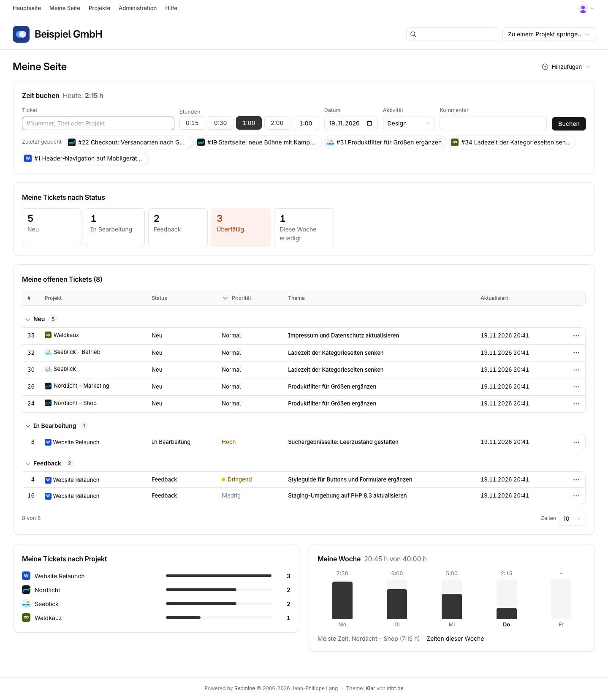
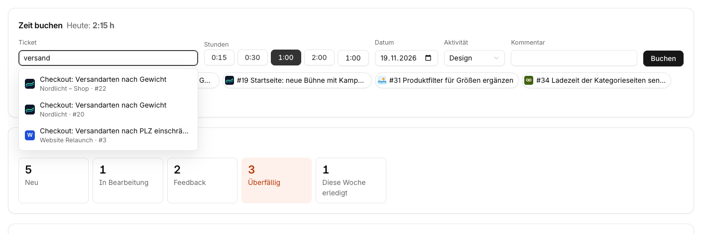
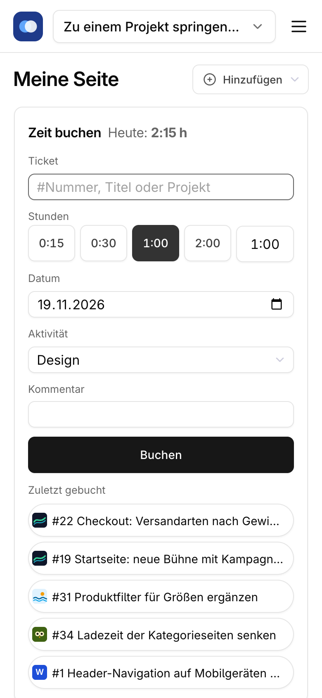

# Dashboard Blocks – more useful blocks for Redmine's "My page"

Redmine's *My page* is a good place to start the day – but its blocks are mostly lists.
This plugin adds four blocks for what you look for every morning and evening: log time
quickly, see where your issues stand, and how your week is going.

- **Log time** – find an issue by number, subject or project, pick a duration (0:15,
  0:30, 1:00, 2:00 or your own), day, activity and comment, and log it without leaving
  the page. *Undo* right after logging, and your recently logged issues are one click
  away.
- **My issues by status** – your open issues as tiles per status, plus *Overdue* and
  *Closed this week*. Every tile opens the matching filtered issue list.
- **My issues by project** – your open issues per top-level project; subprojects count
  towards their parent (with customer projects: per customer). Shows project icons when
  [redmine-project-icons](https://github.com/stbt-de/redmine-project-icons) is installed.
- **My week** – hours logged per day this week against a weekly target (set in the
  block's options, default 40 h), and where most of the time went.

The blocks are added, moved and removed like Redmine's own blocks (*My page → Add*).

Redmine's own **Issues** block (a saved query on *My page*) gets two small additions:
the number of rows can be chosen (10, 25, 50 or all instead of always 10), with
"10 of 23 · Show all" below the list; and without any saved query the block explains how
to create one instead of showing an empty selection. Its column selection and sorting
stay Redmine's own. Works with any theme;
[Klar](https://github.com/stbt-de/redmine-klar-theme) is styled for it.

## Screenshots

*Shown with the [Klar theme](https://github.com/stbt-de/redmine-klar-theme) and example data.*



Log time – search by number, subject or project:



| My page on mobile |
| --- |
|  |

## Installation

The folder in `plugins/` must be named `redmine_dashboard_blocks`.

**Release zip:** download `redmine-dashboard-blocks-v*.zip` from the
[releases](https://github.com/stbt-de/redmine-dashboard-blocks/releases) and unpack it in
the `plugins/` directory (it contains the folder `redmine_dashboard_blocks/`).

**Or clone:**

```
cd /path/to/redmine/plugins
git clone https://github.com/stbt-de/redmine-dashboard-blocks.git redmine_dashboard_blocks
```

Then restart Redmine. No database migration is needed. Each user adds the blocks on
*My page* via *Add*.

To uninstall: remove the blocks from *My page* (or leave them – Redmine skips unknown
blocks), remove the folder and restart Redmine.

### Tested with

| Redmine | Ruby | Rails | Checked |
| --- | --- | --- | --- |
| 7.0.3 | 4.0.10 | 8.1.4 | integration tests; in the browser with the themes Default and Klar (desktop, mobile) |
| 6.1.6 | 3.4.13 | 7.2.4 | integration tests |
| 6.0.12 | 3.3.14 | 7.2.3.2 | integration tests |

The plugin requires Redmine 6.0 or later. The interface is available in English and
German.

## How it works

**Permissions** are Redmine's own: the blocks only count and show issues the user can
see. *Log time* only offers open issues in projects where the user may log time, uses
the project's activities and Redmine's validation (required fields, time format from
*Administration → Settings → Display*). If an entry needs more than the block offers –
for example a required custom field – the block links to the full form. *Undo* is
available when the user may edit their own time entries.

**"My issues"** means issues assigned to the user or to one of their groups, as in
Redmine's own *Issues assigned to me*. Weeks start on the day set under *Administration →
Settings → Display* (or the user's language); non-working days only appear in *My week*
when time was logged on them.

**Log time** uses a small JSON endpoint of the plugin (`/dashboard_blocks/time_entries`)
for the issue search, the project's activities, logging and undo; it works with the
browser session like the rest of Redmine. The stylesheet and script are only loaded on
*My page*.

### For theme authors

The blocks use plain class selectors (`.dashboard-blocks-…`) and a few custom properties
on `:root`, so a theme can restyle them without a specificity fight:
`--dashboard-blocks-border`, `--dashboard-blocks-muted`, `--dashboard-blocks-surface`,
`--dashboard-blocks-accent`, `--dashboard-blocks-alert-bg`, `--dashboard-blocks-alert-text`,
`--dashboard-blocks-success-bg`, `--dashboard-blocks-success-text`.

## Development

Tests run against a fresh Redmine in a container (Docker required):

```bash
dev/run-tests.sh                        # Redmine 7.0
REDMINE_VERSION=6.1 dev/run-tests.sh    # another version
```

Code comments are written in German.

## Built with AI assistance

This plugin was developed together with an AI coding assistant. Most of the code was
written by the assistant; the direction, design decisions and review came from
[stbt.de](https://stbt.de/). Every feature is covered by integration tests and was
checked in a running Redmine.

## License

MIT, see [`LICENSE`](LICENSE).
